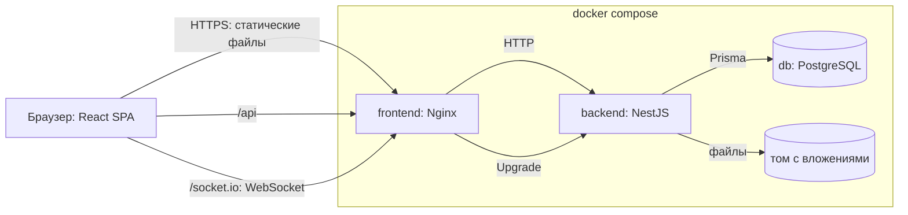
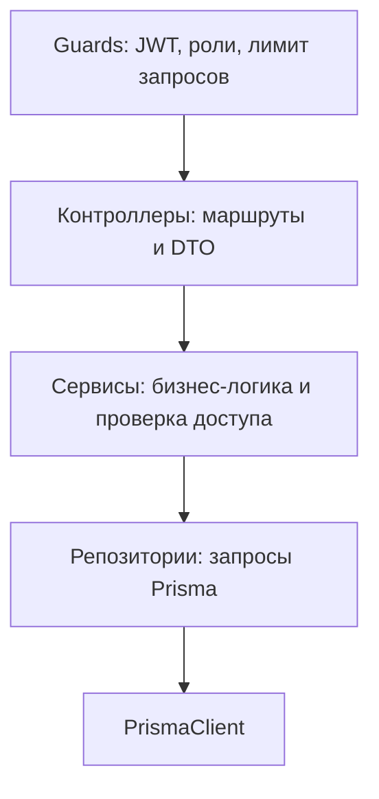
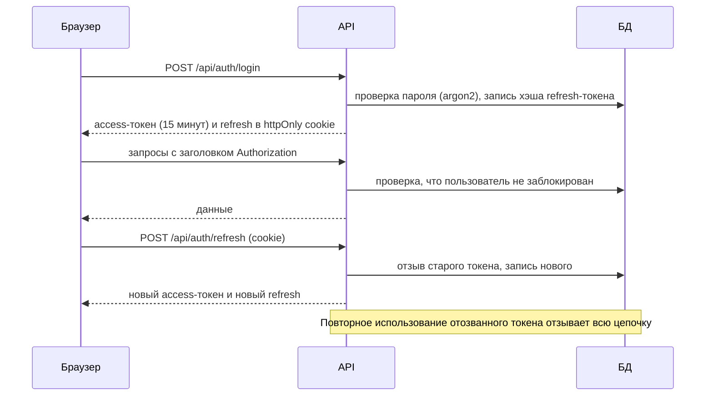
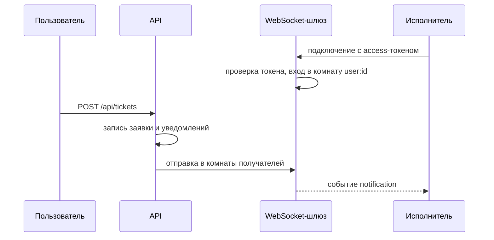
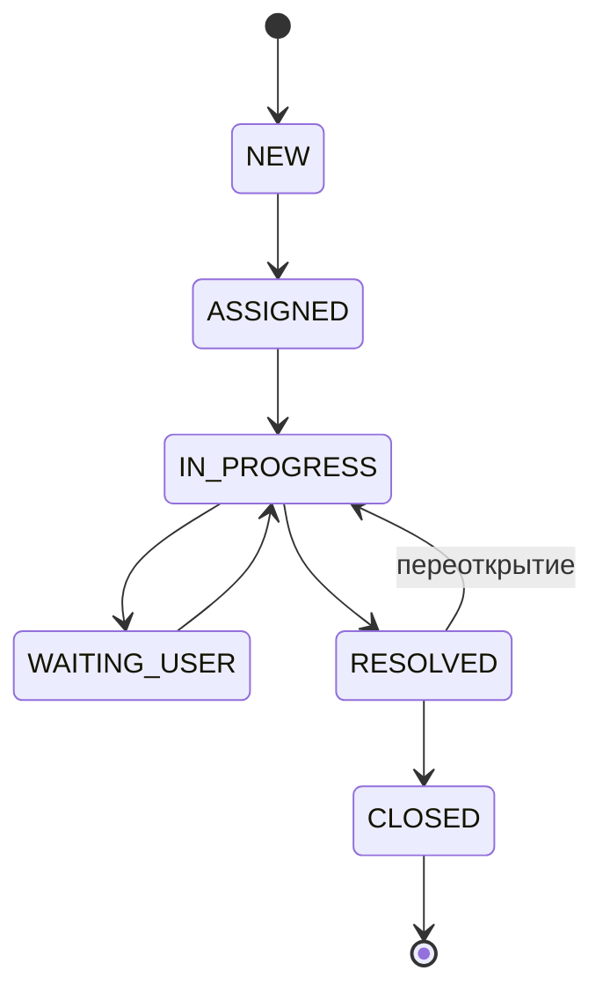

# Архитектура

## Компоненты

## Слои backend

Контроллеры только принимают запрос и вызывают сервис. Сервисы содержат правила: права доступа, переходы статусов, расчёт SLA. Репозитории содержат запросы к базе данных.

Сквозные механизмы: `ResponseInterceptor` формирует ответ `{ data, meta }`, `AllExceptionsFilter` формирует ошибку `{ error }`, глобальный `ValidationPipe` проверяет DTO и возвращает сообщения на русском языке.

## Аутентификация

Access-токен хранится только в памяти браузера, поэтому недоступен после перезагрузки страницы и не лежит в localStorage. Cookie с refresh-токеном недоступна из JavaScript, имеет SameSite=Lax и ограничена путём `/api/auth`.

## Уведомления

## SLA

Фоновая задача с расписанием раз в минуту находит заявки с истёкшими сроками, записывает время просрочки и создаёт уведомления исполнителю и руководителям. Запись времени просрочки гарантирует, что уведомление создаётся один раз.

## Статусы заявки

