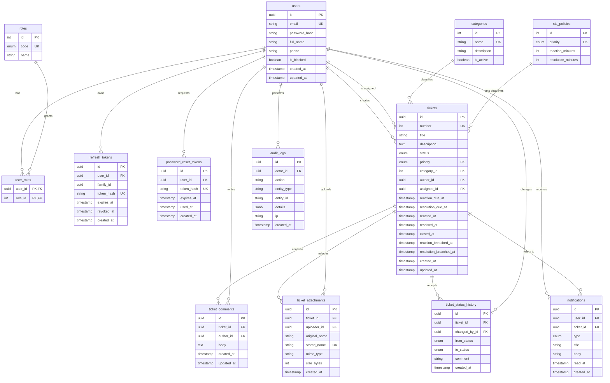

# ER-диаграмма

## Нормализация

- Роли вынесены в справочник `roles`, связь с пользователями M:N хранится в `user_roles`.
- Приоритет в `tickets` является внешним ключом на уникальное поле `sla_policies.priority`, поэтому минуты SLA хранятся только в политике.
- Сроки в заявке являются зафиксированным на момент расчёта фактом: изменение политики не меняет уже созданные заявки.
- Токены хранятся только в виде хэша.
